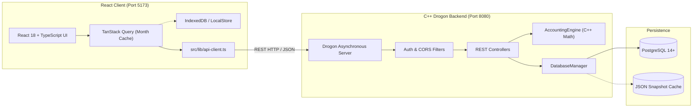

# Shared Table Ledger — Modern Mess Management System

[](https://react.dev)
[](https://drogon.org)
[](https://www.postgresql.org)
[](https://cmake.org)
[](#testing--verification)

> **University Software Development Course Project**  
> A high-performance, transparent mess accounting and hostel management system featuring a modern **React 18 + TypeScript PWA frontend** powered by an asynchronous **C++17 Drogon RESTful backend** and **PostgreSQL database**.

---

## 1. Project Overview

In student dormitories, bachelor messes, and shared flats across South Asia, tracking shared meal consumption, daily food bazaar expenditures, and monthly utility bills is traditionally done on paper ledgers. This manual approach frequently leads to calculation discrepancies, lost receipts, and interpersonal friction.

**Shared Table Ledger** digitizes and automates this entire lifecycle:
- **Transparent Daily Accounting:** Automated calculation of weighted meal rates, individual shares, deposits, and real-time net balances.
- **Sub-Millisecond Backend Performance:** Core business logic and arithmetic are implemented in pure modern C++17 for high concurrency and deterministic accuracy.
- **Offline-First PWA:** Full functionality is maintained even when internet connectivity is intermittent.
- **Multi-Role Security:** Administrative role verification, stateless HS256 JWT sessions, high-entropy guest invite codes, and OWASP formula-injection defense.

---

## 2. System Architecture



---

## 3. Technology Stack

| Layer | Technologies & Tools |
| :--- | :--- |
| **Frontend** | React 18, TypeScript 5, Vite, TanStack Router, TanStack Query, Tailwind CSS, Radix UI primitives, Lucide Icons, Sonner |
| **Backend** | Modern C++17 / C++20, Drogon Web Framework, JsonCpp, CMake 3.16+ |
| **Database** | PostgreSQL 14+, Parameterized Queries, Composite B-Tree Indexes, ACID Transactions |
| **Security** | FIPS 180-4 SHA-256, HMAC-SHA256 JWT, OWASP CSV Formula Injection Sanitization, Scoped Guest Tokens |
| **Testing** | Standalone C++ Unit Test Runner (`AccountingEngineTest.cpp`), Vitest Frontend Test Runner |

---

## 4. Key Application Features

1. **Executive Dashboard:** Live cards displaying total monthly expenses, total meals consumed, current dynamic meal rate, total deposits collected, and net mess balance.
2. **Member Management:** Comprehensive member profiles with room numbers, dietary preferences, join/leave tracking, and balance status.
3. **Daily Meal Tracking:** Record breakfast ($0.5$), lunch ($1.0$), and dinner ($1.0$) tallies per member with batch submission and unique daily constraints.
4. **Expense Categorization:** Distinction between shared food/bazaar expenses (which affect meal rate) and household overhead (rent, utilities, maid, wifi).
5. **Deposit & Payment System:** Member advance payment tracking with payment method attribution (Cash, bKash, Nagad, Bank).
6. **Individual Statements:** Single-click breakdown of meal costs and utility dues versus total paid for each resident.
7. **RFC-4180 CSV Export:** Downloadable financial audit spreadsheets with UTF-8 BOM and formula execution protection.
8. **Guest Joining & Sharing:** Secure 6-digit invite code lookup enabling prospective or guest members to view their ledger.

---

## 5. Getting Started & Installation

### 5.1 Prerequisites
- **Node.js:** v18.0.0 or newer
- **npm:** v9.0.0 or newer
- **C++ Compiler:** MSVC (Visual Studio 2019/2022/2026 Build Tools) on Windows, or GCC 9+ / Clang 10+ on Linux
- **CMake:** Version 3.16 or higher

---

### 5.2 Frontend Setup & Execution

```powershell
# 1. Install Node dependencies
npm install

# 2. Run the React development server
npm run dev
```
The frontend is available at `http://localhost:5173`.

---

### 5.3 C++ Backend Setup & Execution

The C++ Drogon backend is located in `backend-cpp/`.

#### On Windows (Visual Studio / MSVC):
```powershell
cd backend-cpp

# 1. Configure the build directory
cmake -S . -B build

# 2. Compile the standalone test runner
cmake --build build --config Release --target mess_manager_tests

# 3. Run the automated C++ tests
.\build\bin\Release\mess_manager_tests.exe
```

#### On Linux / macOS:
```bash
cd backend-cpp
mkdir -p build && cd build
cmake .. -DCMAKE_BUILD_TYPE=Release
make -j$(nproc)

# Run tests
./mess_manager_tests

# Start the Drogon REST server (Port 8080)
./mess_manager_server
```

---

## 6. Testing & Verification

The project includes dual test suites for comprehensive verification across both stacks:

### 1. Frontend Test Suite (Vitest)
```powershell
npm test
```
- **Results:** 7 test suites, 29 tests covering routing, accounting formulas, security fixes, invite tokens, and offline synchronization. (100% Passing).

### 2. C++ Backend Test Suite
```powershell
.\backend-cpp\build\bin\Release\mess_manager_tests.exe
```
- **Results:** 7 test suites covering standard meal rates, zero-meal edge cases, utility allocations, multi-member monthly ledgers, CSV sanitization, HMAC-SHA256 JWT cryptography, and boundary validation rules. (100% Passing).

---

## 7. Documentation Index

Comprehensive project documentation is maintained in the `docs/` directory:

1. [docs/PROJECT_AUDIT.md](file:///e:/mess%20manager/docs/PROJECT_AUDIT.md) — Initial codebase audit and dependency analysis.
2. [docs/FEATURE_INVENTORY.md](file:///e:/mess%20manager/docs/FEATURE_INVENTORY.md) — Comprehensive inventory of all 15+ application features.
3. [docs/KNOWN_ISSUES.md](file:///e:/mess%20manager/docs/KNOWN_ISSUES.md) — Technical debt and resolved security vulnerabilities.
4. [docs/BUG_FIX_REPORT.md](file:///e:/mess%20manager/docs/BUG_FIX_REPORT.md) — Record of pre-migration bug fixes.
5. [docs/SYSTEM_ARCHITECTURE.md](file:///e:/mess%20manager/docs/SYSTEM_ARCHITECTURE.md) — Deep architectural specification and sequence flows.
6. [docs/CPP_IMPLEMENTATION_GUIDE.md](file:///e:/mess%20manager/docs/CPP_IMPLEMENTATION_GUIDE.md) — C++ architecture, Drogon integration, and build guide.
7. [docs/API_DOCUMENTATION.md](file:///e:/mess%20manager/docs/API_DOCUMENTATION.md) — Full REST API specification with request/response payloads.
8. [docs/DATABASE_DOCUMENTATION.md](file:///e:/mess%20manager/docs/DATABASE_DOCUMENTATION.md) — PostgreSQL ERD, schema constraints, and indexes.
9. [docs/PRESENTATION_GUIDE.md](file:///e:/mess%20manager/docs/PRESENTATION_GUIDE.md) — University presentation slides outline and faculty Q&A preparation.
10. [docs/CPP_CODE_WALKTHROUGH.md](file:///e:/mess%20manager/docs/CPP_CODE_WALKTHROUGH.md) — Line-by-line breakdown of core C++ algorithms.

---

## 8. License & University Course Credits

Developed as a semester project for the **Software Development / Advanced Software Engineering** curriculum.  
All rights reserved © 2026.
